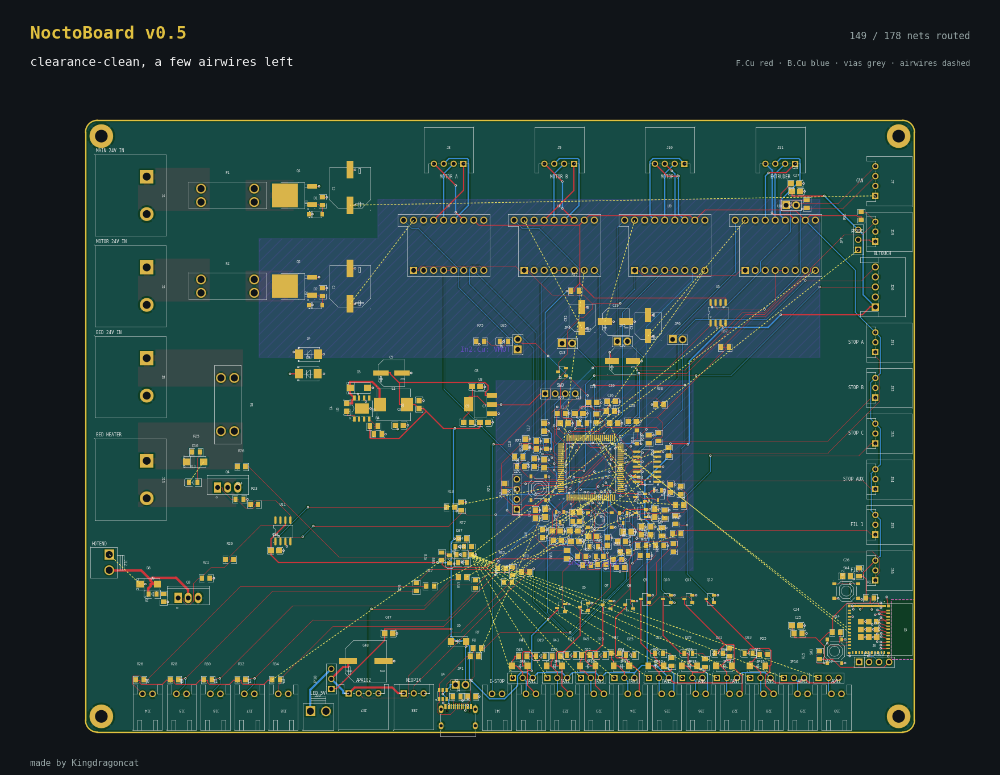

# BoardSnap

**Snap a picture of your KiCad board.** Turn any `.kicad_pcb` into a clean, captioned image. You can also glue a series of saved boards into a timelapse GIF, which is great for build videos, READMEs and progress posts.



- **Reads the board file directly:** works with KiCad 6 to 10 files, with no KiCad install or plugins needed.
- **Shows:** tracks (F.Cu red, B.Cu blue), pads, vias, pours, inner-layer islands, silkscreen, board outline, and dashed **airwires** for anything not routed yet.
- **Counts:** routed nets, tracks, vias and parts, so a caption can say "142 / 178 nets routed" on its own.
- **Your text:** a config file sets the project name, title, caption, footer and colours. You can also type them in when it runs.

## install

```
pip install matplotlib pillow
```

Python 3.11+ reads the `.toml` config out of the box. On older Python, run `pip install tomli` or use a `.json` config.

## use

```
python boardsnap.py MyBoard.kicad_pcb                            # -> MyBoard_snap.png
python boardsnap.py MyBoard.kicad_pcb -c config.toml             # your name / text / colours
python boardsnap.py MyBoard.kicad_pcb --step 3 --caption "placed!" -o step03.png
python boardsnap.py MyBoard.kicad_pcb --ask                      # it asks for title, caption, step
python boardsnap.py MyBoard.kicad_pcb --theme kicad              # night | kicad | oshpark | paper
python boardsnap.py --frames -c config.toml                      # every [[frames]] entry + timelapse.gif
```

## config

Copy `config.example.toml` to `config.toml`. Every field is optional. Text fields can use these placeholders:

| placeholder | becomes |
|---|---|
| `{name}` `{version}` `{author}` | from `[project]` |
| `{step}` | the `--step` number, zero-padded |
| `{nets}` `{routed}` `{unrouted}` `{airwires}` | net counts from the board |
| `{tracks}` `{vias}` `{parts}` `{file}` | board stats / file name |

## timelapse tip

Save a copy of your board at each stage (`board_01_placed.kicad_pcb`, `board_02_power.kicad_pcb`, …). List them as `[[frames]]` in the config and run `--frames`. You get one PNG per stage plus a GIF.

## how it works

`boardsnap.py` is a single file with no hidden services.
1. **Parse:** a tiny s-expression parser reads the board.
2. **Airwires:** a connectivity check (union-find over pads, tracks, vias and zones) finds the unrouted connections.
3. **Draw:** matplotlib draws everything.

Made for NoctoBoard, a Klipper mainboard for a 1 m handmade delta printer.
